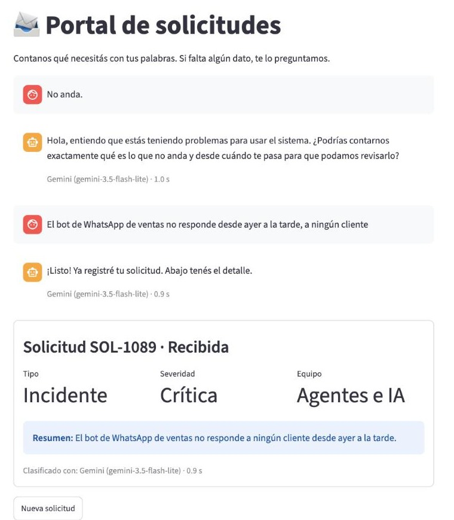
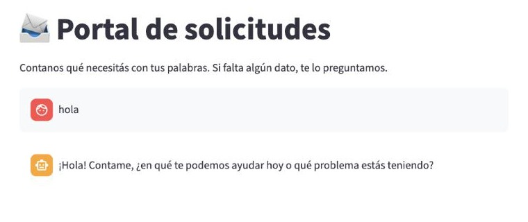
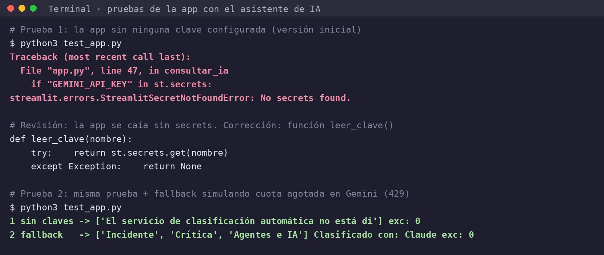
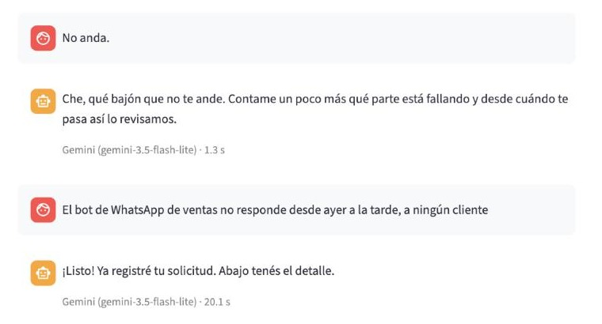

# 📨 Portal de solicitudes con IA

**Enlace a la app:** https://my-app-app-z24zvysqjc5u44cn39qfvg.streamlit.app/
**Autor:** Marcos Posnanski

> Si la app muestra la pantalla "Zzzz", pulsá **"Yes, get this app back up!"** y esperá un minuto: es la suspensión por inactividad del plan gratuito de Streamlit.

## Pitch

1. Los clientes de una empresa de software abren sus solicitudes en una web externa que no se puede personalizar: llegan incompletas o mal clasificadas, alguien las pasa a mano al sistema interno y el cliente no sabe en qué estado están.
2. El Portal de solicitudes es un chat donde el cliente cuenta su problema con sus palabras y sale con su solicitud completa y clasificada, lista para abrirse como ticket.
3. La IA entiende el texto libre, detecta qué falta y lo pregunta de forma natural, y clasifica por tipo, severidad y equipo: un "No anda." termina en un Incidente Crítico para el equipo de Agentes e IA, sin intervención humana.
4. Probarla con casos reales mostró que la IA inventaba acciones y que el modelo "más potente" se colgaba; medir cada respuesta me llevó a cambiarlo y la misma conversación pasó de 20 segundos a 1 segundo por respuesta.
5. El siguiente paso es abrir el ticket directamente en Azure DevOps vía MCP y mostrarle al cliente el estado y los comentarios del equipo, para reemplazar del todo la web del proveedor.

## El problema

Una persona de una empresa cliente, sin perfil técnico, necesita reportar un problema (por ejemplo, un bot que no responde) o pedir un cambio. Hoy lo hace en la web de un proveedor externo que no se puede personalizar, sin ninguna guía, así que las solicitudes llegan incompletas o mal clasificadas. Alguien del equipo tiene que pedir los datos que faltan, clasificarlas y pasarlas a mano al sistema interno, y mientras tanto el cliente no ve en qué estado está su pedido. Resolverlo ahorra idas y vueltas y hace que cada solicitud llegue al equipo correcto con la severidad correcta.

## Qué hace la app

1. El cliente escribe su solicitud en el chat o toca un ejemplo (*Bot caído*, *Cambio*, *Incompleta*).
2. Si falta algún dato, el asistente se lo pregunta (como máximo 3 veces). Si solo saluda, le responde amable y le pide que cuente qué necesita.
3. Cuando la solicitud está completa, ve la ficha con número, tipo, severidad, equipo, resumen y estado.
4. Con **Nueva solicitud** empieza otra.

> **Alcance de esta versión:** la solicitud se completa y clasifica, pero todavía no se abre en ninguna herramienta de tickets. El número y el estado existen solo en la sesión del navegador.

## La pieza de IA

- **Qué usa:** API de Gemini con el modelo `gemini-3.5-flash-lite` (principal) y `gemini-3.8-flash` (respaldo), SDK `google-genai`. Una sola llamada por mensaje devuelve un JSON con la clasificación, los datos que faltan y el texto para el cliente. Hay un tercer nivel con otro proveedor, **Claude** (`claude-haiku-4-5`), preparado en el código pero no activado porque su API es de pago: se activa agregando `ANTHROPIC_API_KEY` en los Secrets.
- **Por qué esa opción:** cada cliente lo cuenta a su manera; un formulario fijo o un clasificador zero-shot no pueden razonar qué dato falta ni redactar la repregunta. Flash-Lite va primero porque en la prueba Flash se colgaba (20,1 s) y Flash-Lite respondía en 0,9–1,0 s.
- **Qué pasa si falla:** si se acaba la cuota o un modelo no responde en 12 s, pasa al siguiente y lo indica debajo del mensaje. Si no responde ninguno, o no hay conexión, muestra "El asistente no está disponible en este momento… volvé a enviar el mensaje" y la app no se cae.

## Cómo la he construido

- **Herramientas:** Claude como asistente de IA, trabajando paso a paso; los Colab de las sesiones 3 y 4 como guía; GitHub web y Streamlit Community Cloud.
- **Fichero de contexto del agente:** [AGENTS.md](AGENTS.md) (y [CLAUDE.md](CLAUDE.md), que remite a él).
- **Prompts clave** (registro completo en [prompts.md](prompts.md)):
  1. "Qué hará la app: guiar al cliente con una conversación hasta completar la solicitud, clasificarla por tipo, severidad y equipo […]" / "hagamos todo pero por pasos, no construyas todo de una […] quiero entender qué hacemos y cómo"
  2. "Pongamos [una] apikey como fallback y que ninguna apikey quede en código público de GitHub"
  3. "Estos son los Colab de sesión 3 y 4 que tengo pendientes y serían el paso a paso para construir el trabajo final"
  4. "¿Pero poner estas claves de esta forma es lo que el profesor pide? ¿Estamos seguros?" / "¿Y en el PDF?"
  5. "Me parece que la app no funciona muy bien"
- **Qué delegué al agente y qué revisé a mano:** delegué escribir `app.py`, el prompt y el manejo de errores, probar los flujos con la IA simulada y redactar la documentación. Revisé yo: el alcance (Azure DevOps fuera de esta versión), que ninguna clave estuviera en el repo, que lo de las claves coincidiera con el PDF y el Colab (no lo acepté sin fuente), que la app "no funcionaba muy bien" aunque el agente la daba por buena, y elegir el modelo con el dato medido. Las pruebas del agente detectaron que la primera versión se caía sin secrets (`StreamlitSecretNotFoundError`), y se corrigió con `leer_clave()`.

## Prueba y mejora

| Quién la probó | Qué probó | Qué pasó | Qué cambié |
|---|---|---|---|
| Yo, como usuario cliente | "hola" | Respuesta robótica ("Saludo inicial del cliente sin especificar motivo…") y gastaba una repregunta | Campos `es_solicitud` y `mensaje_al_cliente`: saludo amable sin gastar repregunta |
| Yo, como usuario cliente | "No anda." y "El reporte mensual no muestra octubre" | La IA inventaba acciones: "ya lo pasé al equipo", "estuve mirando tu caso" | Reglas explícitas en el prompt |
| Yo, como usuario cliente | Escribir mientras decía "Analizando…" | Se perdía la respuesta anterior | Chat bloqueado mientras la IA responde |
| Yo, como usuario cliente | Conversación completa, midiendo tiempos | 20,1 s por respuesta: Flash se colgaba y siempre terminaba respondiendo Flash-Lite | Flash-Lite como principal y timeout de 12 s → **0,9–1,0 s** |
| Yo, como usuario cliente | "No anda." | Tono demasiado informal ("Che, qué bajón") | Tono cordial y profesional en el prompt |

## Ejecutar en local (opcional)

```bash
pip install -r requirements.txt
# Ruta A: poned la clave en .streamlit/secrets.toml y ejecutad
streamlit run app.py
```

`.streamlit/secrets.toml` (solo en local, está en `.gitignore`):

```toml
GEMINI_API_KEY = "pegad-aqui-vuestra-clave"
# ANTHROPIC_API_KEY = "..."   # opcional: activa el respaldo con Claude
```

## Capturas

1. **La app funcionando:** "No anda." → la IA repregunta → la respuesta del cliente se clasifica como Incidente · Crítica · Agentes e IA, en ~1 s por respuesta.

   

2. **Caso límite:** un saludo no es una solicitud; la app responde amable, no gasta repregunta y no crea ficha.

   

3. **Trabajo con la IA:** las pruebas detectan que la primera versión se caía sin secrets; corrección con `leer_clave()` y prueba del fallback (IA simulada).

   

4. **La prueba:** antes de la mejora, tono informal y 20,1 s de respuesta; ese dato llevó a cambiar el modelo principal.

   
